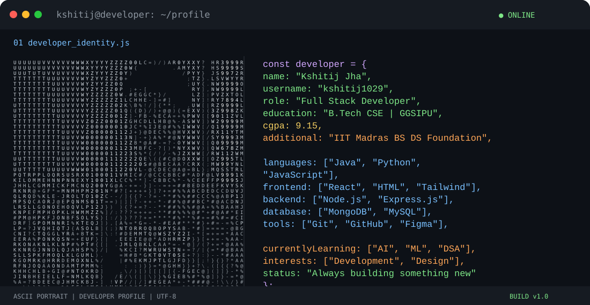

# KSHITIJ JHA
**Full Stack Developer | AI/ML Enthusiast | Creative Designer**

Building at the intersection of code, creativity and innovation.

---

<table>
<tr>
<td width="30%" valign="top">

### Kshitij Jha

`Developer.exe`

New Delhi, India

**ABOUT**

- B.Tech CSE @ GGSIPU
- CGPA: 9.15
- IIT Madras BS Data Science Foundation Level completed

**CURRENTLY EXPLORING**

- Artificial Intelligence
- Machine Learning
- DSA & Problem Solving
- UI/UX Design

**CONTACT**

- [LinkedIn](https://www.linkedin.com/in/kshitij2207jha/)
- [Portfolio](https://new-portfolio-taupe-chi-92.vercel.app/)
- [Email](mailto:connect.kshitijjha@gmail.com)

</td>

<td width="70%" valign="top">

</td>
</tr>
</table>

---

## `$ tech_stack --all`

---

## `$ git log --featured-projects`

[ResumeCO Live Demo](https://resume-co-lake.vercel.app/) · [SEO Rank Tracker Live Demo](https://seo-rank-tracker-teal.vercel.app/)

---

## `$ github --stats`

 

---

## `$ contributions --visualize`

---

### `while(alive) { keepBuilding(); }`

**Code. Create. Learn. Repeat.**

